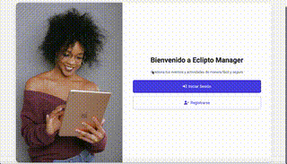

<div align="center">
  <h1>🎫 Eclipto Manager</h1>
  <p>Event management and ticket sales system</p>
    

</div>

<div align="center">
  <a href="https://angular.io/docs" target="_blank">
    
  </a>
  <a href="https://docs.spring.io/spring-boot/docs/current/reference/html/" target="_blank">
    
  </a>
  <a href="https://www.postgresql.org/docs/" target="_blank">
    
  </a>
</div>

## 📋 Description

  Eclipto Manager is a modern web application for event management and ticket sales. It allows organizers to create and manage events, while users can purchase tickets securely and easily.

## ✨ Main

  - 🔐 Authentication with JWT and Google Sign-In
  - 👥 User roles (Admin/User)
  - 📅 Complete event management
  - 🎟️ Ticket sales system
  - 📊 Admin dashboard
  - 📱 Responsive design

## 🚀 Instalación rápida (local)

### Requisitos
- Node.js (v18+)
- Java JDK 17
- PostgreSQL
- Maven

### 1) Base de datos
Crear la base y el usuario en PostgreSQL:
- Base: `code_reader_app`
- Usuario: `code-reader`
- Password: `code-reader`

La app se conecta usando esta configuración:
```properties
spring.datasource.url=jdbc:postgresql://localhost:5432/code_reader_app
spring.datasource.username=code-reader
spring.datasource.password=code-reader
```

### 2) Backend (Spring Boot)
```bash
cd code-reader-backend/demo
mvn clean install
mvn spring-boot:run
```

Backend en `http://localhost:8080`

### 3) Frontend (Angular)
```bash
cd code-reader-frontend/ticket-reader-angular
npm install
npm start
```

Frontend en `http://localhost:4200`

### 4) Configuración opcional
Si quieres activar Google Sign-In o email, configura variables de entorno antes de arrancar el backend:

```bash
export GOOGLE_CLIENT_ID="TU_GOOGLE_CLIENT_ID.apps.googleusercontent.com"
export SPRING_MAIL_USERNAME="tu_email@gmail.com"
export SPRING_MAIL_PASSWORD="tu_app_password"
```

Notas:
- Para Gmail usa **App Password** (no tu contraseña normal).
- El `GOOGLE_CLIENT_ID` debe coincidir con el Client ID configurado en el frontend.
  - Frontend: `code-reader-frontend/ticket-reader-angular/src/main.ts` (`GoogleLoginProvider`)

### 5) Endpoints locales por defecto
- API: `http://localhost:8080`
- Uploads: `http://localhost:8080/api/uploads`


<div align="center">
  <p>Developed with ❤️ By <a href="https://github.com/HugoNienhausen">Hugo Nienhausen</a></p>
</div>
